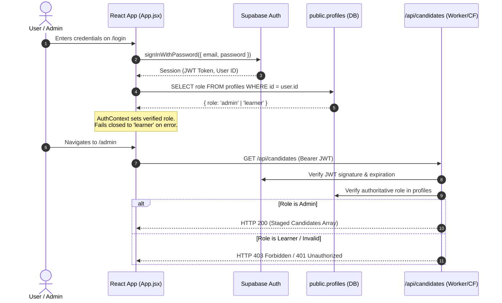
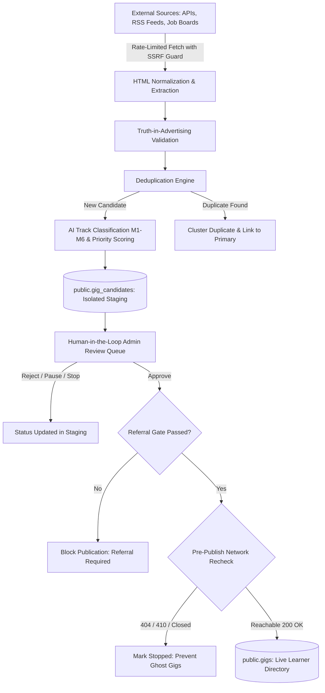

# UpShift Gig Network — AI Discovery Engine & Student Opportunity Platform

> **Status:** Production-Ready | Cleaned & Verified
> **Test Suite:** 337/337 Automated Tests Passing across 47 Suites (100% Pass Rate)
> **Security Gate:** Bundle Secret Scan Passed (0 Server Keys Leaked) | Linter Passed (0 Errors)

---

## 1. Project Purpose & Main Features

**UpShift** is a dual-sided platform connecting student learners with verified, paid micro-gigs across six targeted career tracks (**M1–M6**):
- **M1:** Micro-Tasks & Content Moderation
- **M2:** Data Annotation & AI Operations
- **M3:** Web & Mobile Technical Development
- **M4:** System Operations, Cloud & Automation
- **M5:** UI/UX Design & Creative Assets
- **M6:** Specialized Technical Projects & Machine Learning

### Main Features
1. **Automated AI Discovery Engine:** Ingests live listings from permitted external sources (APIs, RSS feeds, curated job boards) with rate limiting, robots.txt compliance, and zero authentication bypass.
2. **Deterministic & LLM Classification:** Normalizes untrusted HTML, extracts compensation and requirements, scores module relevance (0–100), and computes composite review priority.
3. **Multi-Tier Deduplication:** Uses canonical URL normalization, source listing IDs, and MD5 content hashes to cluster and neutralize duplicates before review.
4. **Isolated Staging Repository:** Unreviewed listings enter an isolated staging area (`public.gig_candidates`), protected by PostgreSQL Row-Level Security (RLS) so learners cannot view or query unapproved gigs.
5. **Human-in-the-Loop Admin Review Queue:** Interactive dashboard for reviewing, filtering, editing, approving, pausing, and rejecting candidate gigs.
6. **Mandatory Referral Gate & Pre-Publication Reachability:** Opportunities requiring referral links cannot be published without valid referral metadata. Before promotion to live status, the engine conducts live reachability probes (blocking dead 404/410 links).
7. **RFC 4180 19-Column CSV Export:** Supports spreadsheet interoperability with automatic CSV formula-injection neutralization (`=`, `+`, `-`, `@`, `|`, `%`).
8. **Automated Health Monitoring & Daemon:** Daily cron scheduler and continuous background daemon to check live listing reachability and degrade dead listings to `Stopped`.

---

## 2. Technology Stack

| Technology | Role | What It Does In This Project |
| :--- | :--- | :--- |
| **React 19** | Frontend Framework | Powers learner and administrator user interfaces with client-side state management, custom hooks, and component hierarchy. |
| **Vite 6** | Build Tool & Local Server | Compiles production assets and runs the local development server with built-in API middleware for backend parity. |
| **React Router 7** | Client-Side Routing | Provides declarative navigation (`/dashboard`, `/admin`, `/login`, `/signup`) with role-aware route guards (`ProtectedRoute`). |
| **Vanilla CSS** | Styling System | Custom responsive design system without utility-framework bloat, including desktop and mobile-optimized layouts. |
| **Supabase JS (v2.45)** | Client SDK | Manages authentication sessions (JWT), handles client-side queries, and communicates with Supabase Auth and PostgREST. |
| **PostgreSQL & Supabase** | Relational Database & RLS | Hosts primary schemas (`public.gigs`, `public.gig_candidates`, `public.profiles`, `public.discovery_jobs`) with strict Row Level Security. |
| **Cloudflare Pages & Functions** | Production Hosting & Serverless API | Hosts the static frontend bundle and runs serverless functions (`functions/api/candidates.js`, `functions/api/discovery/`) in production. |
| **Node.js Built-in Test Runner** | Automated Testing | Fast native test runner (`node --test`) executing 293 unit, integration, UI, security, and regression tests. |
| **Oxlint** | Linter | High-performance linter enforcing code quality and identifying unused variables and React anti-patterns. |

---

## 3. Prerequisites & Local Setup

### 3.1. Prerequisites
- **Node.js:** v20.x or higher
- **npm:** v10.x or higher
- **Git:** Standard git client

### 3.2. Local Setup
```bash
# 1. Clone repository
git clone <repo-url>
cd upshift

# 2. Install dependencies (frozen lockfile)
npm install

# 3. Configure local environment variables
cp .env.example .env

# 4. Start local development server
npm run dev
```

The application will be available at:
- **Learner Portal:** [http://localhost:5173/dashboard](http://localhost:5173/dashboard)
- **Admin Review Queue:** [http://localhost:5173/admin](http://localhost:5173/admin)
- **Sign In / Sign Up:** [http://localhost:5173/login](http://localhost:5173/login)

---

## 4. Environment Variables

Environment variables are partitioned into **client-safe** (prefixed with `VITE_`) and **server-only** (never exposed to the browser).

| Variable Name | Exposure | Required For | Purpose |
| :--- | :--- | :--- | :--- |
| `VITE_SUPABASE_URL` | Public / Client | Frontend & Backend | HTTPS URL of your Supabase instance. |
| `VITE_SUPABASE_ANON_KEY` | Public / Client | Frontend & Backend | Supabase publishable anonymous key for browser authentication & public RLS queries. |
| `SUPABASE_SERVICE_ROLE_KEY`| Server-Only | Background Workers & API | Privileged service key bypassing RLS for ingestion and staging queue management. |
| `DATABASE_URL` | Server-Only | Migrations & Direct DB | PostgreSQL connection string for database administration. |
| `LLM_PRIMARY_PROVIDER` | Server-Only | Discovery Worker | Primary LLM provider (`groq` or `gemini`). |
| `LLM_FALLBACK_PROVIDER` | Server-Only | Discovery Worker | Secondary fallback provider (`gemini` or `groq`). |
| `GROQ_API_KEY` | Server-Only | Discovery Worker | API key for Groq Cloud inference (Qwen/Llama models). |
| `GEMINI_API_KEY` | Server-Only | Discovery Worker | API key for Google Gemini Flash Lite models. |
| `CANDIDATE_STORAGE` | Server-Only | Discovery Worker | Target repository: `supabase` (persistent database) or `json` (local dev file). |
| `DISCOVERY_DEFAULT_SOURCE`| Server-Only | Discovery Worker | Default source scope (`all`, `api`, `rss`, `fixtures`). |
| `DISCOVERY_BATCH_LIMIT` | Server-Only | Discovery Worker | Number of items to process per ingestion cycle (e.g. `10` or `50`). |

> [!WARNING]
> Never prefix `SUPABASE_SERVICE_ROLE_KEY`, `GROQ_API_KEY`, or `GEMINI_API_KEY` with `VITE_`. The automated security scanner (`npm run verify:secrets`) verifies that no private keys exist in the built client bundle.

---

## 5. Development, Test, Lint, Build & Security Commands

```bash
# Start local Vite development server with API proxy middleware
npm run dev

# Run complete automated test suite (293 tests across 38 suites)
npm test

# Run Oxlint high-speed linter across all source files
npm run lint

# Compile production client bundle into dist/
npm run build

# Verify compiled bundle contains zero server-side secrets or private keys
npm run verify:secrets

# Preview compiled production build locally
npm run preview

# Run manual single-pass discovery worker (fetches and stages gigs)
npm run worker:discover

# Run single-pass daily health check against active opportunities
npm run monitor:health

# Start background health monitoring daemon (runs 24h cron cycle)
npm run monitor:daemon
```

---

## 6. Folder Structure

```
upshift/
├── .github/workflows/          # CI/CD and scheduled cron workflows
│   ├── daily-health-check.yml  # Daily 02:00 UTC health check workflow
│   └── scheduled-discovery.yml # 12-hour automated discovery ingestion
├── data/                       # Local application datasets and persistence
│   ├── candidates.json         # Canonical 221-record candidate dataset
│   ├── sources.json            # Permitted source registry and health metadata
│   └── sample_export_150.csv   # Reference 150-row RFC 4180 export
├── docs/                       # Technical architecture and interview guides
│   ├── ARCHITECTURE.md         # Component diagrams, request flows, and security model
│   ├── API.md                  # REST endpoints and Cloudflare Pages Functions
│   ├── DATABASE_ERD.md         # Database schema, table relationships, and indexes
│   ├── FINAL_FRD_COMPLIANCE_REPORT.md # Comprehensive specification compliance report
│   ├── FRD_COMPLIANCE_MATRIX.md# Clause-by-clause requirement trace
│   ├── LIMITATIONS.md          # Known constraints, technical debt, and roadmap
│   └── interview-prep.md       # Tailored technical interview study guide
├── functions/api/              # Cloudflare Pages Functions (serverless production API)
│   ├── candidates.js           # GET /api/candidates, POST /api/candidates (updates)
│   └── discovery/              # POST /api/discovery/run, GET /api/discovery/status
├── public/                     # Static browser assets
├── scripts/                    # Verification and evaluation utilities
│   ├── verify_bundle_secrets.mjs # Production bundle secret leakage gate
│   ├── run_live_discovery_eval.mjs # Benchmark for real-world discovery sources
│   └── scan_duplicates.mjs     # Standalone duplicate detection diagnostic
├── src/                        # Core application source code
│   ├── discovery/              # Discovery domain logic & data transformations
│   │   ├── candidateStore.js   # Repository interface (Supabase & JSON storage)
│   │   ├── csvExport.js        # 19-column RFC 4180 exporter with formula sanitization
│   │   └── types.js            # Enums, statuses, and validation schemas
│   ├── lib/                    # Shared client singletons (Supabase client)
│   │   └── supabase.js         # Browser Supabase client initialization
│   ├── pages/                  # Top-level route views
│   │   ├── Dashboard.jsx       # Learner opportunity browsing & admin dashboard
│   │   ├── CandidateReviewQueue.jsx # Admin review queue and curation interface
│   │   ├── Login.jsx           # Sign in view
│   │   └── Signup.jsx          # User registration view
│   ├── server/                 # Backend ingestion, security, and scheduling modules
│   │   ├── candidateApiHandler.js # Dev server API middleware with auth validation
│   │   ├── crawler.js          # Resilient HTTP fetcher with SSRF protection
│   │   ├── deduplicator.js     # Exact and fuzzy candidate deduplication engine
│   │   ├── moduleClassifier.js # Track classification (M1–M6) and scoring
│   │   ├── monitor.js          # Health check runner for live opportunities
│   │   └── worker.js           # CLI discovery worker entry point
│   ├── App.jsx                 # Application root, auth state provider, and router
│   ├── index.css               # Vanilla CSS design system and responsive styles
│   └── main.jsx                # React DOM entry point
├── supabase/migrations/        # Database migrations and RLS policies
│   ├── 20261012000000_security_hardening.sql # Base RLS policies & profile protection
│   ├── 20261012000001_gig_candidates_staging.sql # Staging table schema & admin RLS
│   ├── 20261015000000_discovery_jobs.sql # Discovery jobs queue & lease locking
│   └── 20261015000001_gig_candidates_health_and_referrals.sql # Health check & referral schema
├── tests/                      # Automated test suite (14 test files, 293 tests)
└── vite.config.js              # Vite configuration and candidate API middleware
```

---

## 7. Authentication & Authorization Flow



### Security Safeguards
1. **Zero Client Trust:** The frontend `role` state is used solely for UI rendering. Every mutation and privileged read is authoritatively validated server-side by checking the user's record in `public.profiles`.
2. **Fail-Closed Hydration:** If profile loading fails or is delayed, the application defaults to the least-privilege `learner` role. Tampering with `localStorage` cannot bypass server-side API or database RLS checks.
3. **Database Trigger Protection:** Migration `20261012000000_security_hardening.sql` defines trigger `trg_protect_profile_role` on `public.profiles`. Non-admin callers cannot alter their own `role` column.

---

## 8. Discovery, Validation, Deduplication, Review & Publication Pipeline



1. **Ingestion & SSRF Protection:** Crawlers query permitted external endpoints. All URLs pass through `validateSafeUrl` and `safeFetch` to block private IP ranges (`127.0.0.1`, `10.0.0.0/8`, `192.168.0.0/16`), cloud metadata (`169.254.169.254`), and DNS-rebinding attacks.
2. **Normalization & Truth-in-Advertising:** Raw HTML is stripped of malicious schemes (`javascript:`, `data:`). Missing pay or deadlines are never fabricated; unspecified compensation is explicitly stored as `"Unspecified"`.
3. **Multi-Key Deduplication:** Compares canonical URLs, external listing IDs, and MD5 body hashes. Matching listings are clustered without creating duplicate rows.
4. **Isolated Staging:** Opportunities are stored in `public.gig_candidates` with an initial status of `pending_review`.
5. **Human Approval:** Administrators review listings in `CandidateReviewQueue.jsx`.
6. **Mandatory Referral Gate:** If `referral_required` is true, the candidate cannot be published without a valid `referral_id` or `referral_url`.
7. **Pre-Publication Network Recheck:** Immediately prior to insertion into `public.gigs`, the target URL is probed. If the link has died (HTTP 404/410), publication is blocked and the candidate is marked `Stopped`.

---

## 9. Database Tables & Migrations

### Core Tables
- `public.gigs`: Live opportunity directory visible to learners. Only approved, active listings are queryable by learners via RLS.
- `public.gig_candidates`: Isolated staging repository for discovered listings. Protected by RLS so that only verified administrators (`public.is_admin()`) have read and write permissions.
- `public.profiles`: User profiles linked to `auth.users(id)`. Contains the authoritative `role` field (`admin` vs `learner`).
- `public.discovery_jobs`: Job coordination table for scheduled and manual discovery runs, using `FOR UPDATE SKIP LOCKED` for concurrency control.

### Purpose of Existing Migrations
1. **`20261012000000_security_hardening.sql`:**
   - Cleans legacy permissive policies from `gigs` and `profiles`.
   - Enforces RLS on `public.gigs` (public/learners see active gigs; admins see all; mutations restricted to `is_admin()`).
   - Installs `trg_protect_profile_role` trigger on `public.profiles` to prevent role escalation.
   - Revokes excessive database permissions from public roles.
2. **`20261012000001_gig_candidates_staging.sql`:**
   - Creates the staging table `public.gig_candidates` with classification metadata, fit scores, and source tracking.
   - Enforces strict RLS allowing access exclusively to administrators.
3. **`20261015000000_discovery_jobs.sql`:**
   - Creates `public.discovery_jobs` to track crawler execution, lease expiration, and execution results.
   - Provides PostgreSQL function `claim_discovery_job` with lease timeouts to prevent overlapping worker jobs.
4. **`20261015000001_gig_candidates_health_and_referrals.sql`:**
   - Extends `public.gig_candidates` with columns for health monitoring (`health_check_error`, `last_health_check_at`) and referral tracking (`referral_id`, `referral_url`, `referral_required`, `referral_history`).
   - Broadens candidate lifecycle check constraints to support canonical states (`Active`, `Paused`, `Stopped`, `Needs Review`).

---

## 10. Deployment Architecture & GitHub Actions

### Deployment Architecture
- **Frontend Hosting:** Cloudflare Pages deploys static assets compiled by Vite.
- **API Functions:** Cloudflare Pages Functions (`functions/api/`) execute serverless API endpoints using Cloudflare's edge runtime.
- **Local Dev Parity:** Vite dev server uses `candidateApiPlugin` (`vite.config.js`) to route `/api/candidates` and `/api/discovery/*` to Node.js handlers with identical auth checks.
- **Database & Auth:** Hosted Supabase PostgreSQL instance with PostgREST and Supabase Auth.

### GitHub Actions Workflows
- **`daily-health-check.yml`:**
  - **Trigger:** Scheduled daily at 02:00 UTC (or manually via workflow dispatch).
  - **Action:** Runs `node src/server/monitor.js --storage=supabase` to verify URL availability across active gigs and record source health.
- **`scheduled-discovery.yml`:**
  - **Trigger:** Scheduled every 12 hours (00:00 and 12:00 UTC, or manually).
  - **Action:** Executes `node src/server/worker.js --storage=supabase` to query permitted sources and stage new opportunities.

---

## 11. Known Limitations & Troubleshooting

### Known Limitations
1. **Dynamic Single-Page App (SPA) Crawling:** The crawler relies on standard HTTP fetching and fast DOM parsing. Opportunities rendered exclusively through complex client-side JavaScript or behind bot-mitigation CAPTCHAs are excluded.
2. **Local Development Storage Mode:** In local development without Supabase credentials, the app defaults to `data/candidates.json`. Concurrent multi-process writes to the local JSON file can encounter file locks.
3. **LLM Provider Quotas:** LLM classification utilizes free-tier Groq and Gemini models. If rate limits are reached, the system gracefully falls back to deterministic rule-based keyword matching without pipeline failure.

### Troubleshooting
- **Tests Fail on Port Conflict or Lock:** Ensure no other instance of `npm run monitor:daemon` or Vite is running. If `data/*.lock` files persist after a crash, remove them.
- **Unauthorized on `/admin`:** Ensure your user in `public.profiles` has `role = 'admin'`. In local development without Supabase, set the user profile role in local state.
- **Production Build Secret Scanner Warning:** Run `npm run verify:secrets`. If a secret is flagged, check that no `process.env` variable containing a service key was prefixed with `VITE_`.
