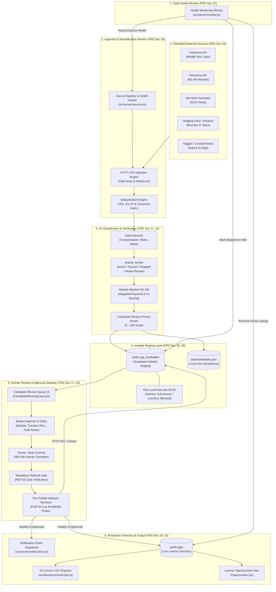

# UpShift AI Gig Discovery Engine — Architecture & System Design

> **Document Version:** 1.0  
> **FRD Reference:** FRD v1.0 Section 19, 26 (Deliverable #42)  
> **Status:** Verified Active Implementation  

---

## 1. Executive Summary

The **UpShift AI Gig Discovery Engine** is a high-reliability, automated opportunity ingestion, classification, verification, and human-in-the-loop publishing pipeline. It continuously scans permitted external data providers, extracts and validates structured gig data, categorizes listings into six distinct UpShift modules (**M1–M6**), isolates unapproved listings in a secure staging repository, and publishes verified opportunities to the learner directory only after human administrator approval and automated network availability checks.

---

## 2. System Architecture Diagram

---

## 3. Core Component Subsystems

### 3.1. External Ingestion & Source Registry (`src/server/sources.js`)
- **Permitted Sources:** Arbeitnow, Remotive, We Work Remotely, Hugging Face, Devpost, Kaggle, Contra.
- **Constraints (`SRC-01`, `SRC-02`, `SRC-03`):** Public feeds and APIs only. Zero bypass of authentication, paywalls, or CAPTCHA. Strict per-source rate limiting (10–60 RPM).
- **Health Tracking (`SRC-05`):** Tracks `consecutive_errors`, `last_checked_at`, `total_discoveries`, and flags sources as `healthy`, `degraded`, or `failing`.

### 3.2. Extraction & Verification Engine (`src/server/activityVerifier.js`, `pipeline.js`)
- **Canonical Activity States:** `Active`, `Paused`, `Stopped`, and `Needs Review`.
- **Truth In Advertising:** Never fabricates missing compensation or dates (`T07`, `T08`). If compensation is unspecified, records `"Unspecified"` and sets numeric ranges to `0`.
- **Deduplication:** Normalizes URLs and checks `external_gig_id` and `source_listing_id` before inserting records.

### 3.3. Isolated Staging Layer (`public.gig_candidates`)
- Staging table separated from live learner table (`public.gigs`).
- **PostgreSQL RLS:** `Admins have full access to gig_candidates` enforces `is_admin()`. Anonymous clients receive `401 / 42501 (permission denied)`. Authenticated learners receive `[]` (zero rows) and zero write access.

### 3.4. Human Approval Gateway & Safety Constraints (`src/discovery/candidateStore.js`)
- **Approval Gate (`REV-01`, `T10`):** No candidate can transition to live gigs without explicit `approved` status.
- **Mandatory Referral Gate (`REF-03`, `T12`):** When `referral_required: true`, publishing is strictly blocked if `referral_id` or `referral_url` is missing.
- **Pre-Publication Reachability Recheck (`PUB-02`, `VER-08`, `T11`):** Immediately before insertion into `public.gigs`, the engine performs an automated network probe. If the target URL returns 404, 410, or closed signals, the candidate is marked `Stopped` and publishing is aborted.

### 3.5. 19-Column CSV Contract (`src/discovery/csvExport.js`)
- Generates exact RFC 4180 compliant CSV exports matching the 19 required columns in exact specification order:
  `external_gig_id`, `title`, `track_id`, `payment_amount`, `compensation_type`, `min_amount`, `max_amount`, `currency`, `priority`, `is_featured`, `is_local_business`, `posted_at`, `origin_url`, `short_description`, `overview`, `responsibilities`, `deliverables`, `requirements`, `proof_spec`.
- Strictly filters out unapproved, paused, rejected, or stopped records (`T13`).

### 3.6. Scheduled Health Monitoring (`src/server/monitor.js`)
- Daily / continuous daemon that re-verifies active opportunities.
- Prevents false `Active` states (`PUB-05`): dead listings are downgraded to `Stopped`, and `opportunity.health_status_changed` notifications are dispatched.

---

## 4. Security & Boundary Architecture

| Boundary | Mechanism | Verification Method |
| :--- | :--- | :--- |
| **Database Permissions** | `REVOKE` excessive grants from `anon` & `authenticated` | `information_schema.role_table_grants` |
| **Learner Isolation** | Row Level Security (RLS) with `is_admin()` policy | REST API probe returned `HTTP 200 []` |
| **Server Secrets** | Strict server-side isolation; no `VITE_` prefix on service keys | Automated scan (`scripts/verify_bundle_secrets.mjs`) |
| **Production Shield** | Standalone dev database; zero prod migrations executed | Isolated config verification |
