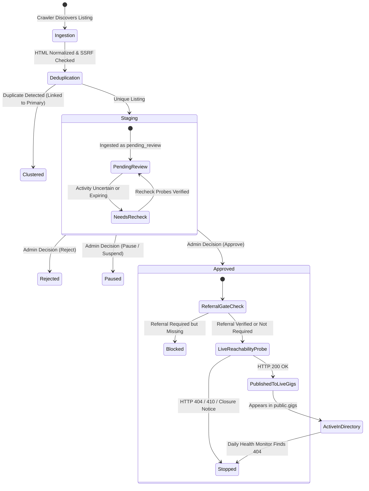
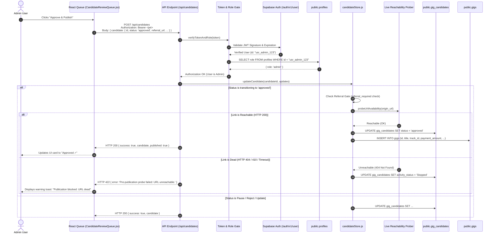

# UpShift AI Gig Network — System Architecture & Component Design

> **Document Version:** 2.0 (Cleaned & Verified)
> **Target Audience:** Engineering Team & Technical Interviewers
> **Status:** Production-Ready Architectural Documentation

---

## 1. System Overview

**UpShift** is an automated micro-gig aggregation and publishing platform designed to bridge student learners with verified, paid freelance opportunities. The system continuously ingests listings from permitted external sources, normalizes and classifies listings into six career tracks (**M1–M6**), isolates unreviewed listings in a secure staging repository, and publishes opportunities to the live directory only after human administrator approval and pre-publication network reachability verification.

---

## 2. Component Relationship Diagram

```mermaid
graph TB
    subgraph Client_Tier["Client Tier (React 19 + React Router 7 + Vanilla CSS)"]
        UI_LEARNER["Learner Portal (/dashboard)<br/>Browse M1-M6, Save, Track Applications"]
        UI_ADMIN["Admin Review Queue (/admin)<br/>Review, Filter, Edit, Approve, Export"]
        AUTH_CTX["AuthContext & useAuth()<br/>Session Management & Fail-Closed Hydration"]
    end

    subgraph Edge_API_Tier["API & Backend Services"]
        CF_CANDIDATES["Cloudflare / Local API (/api/candidates)<br/>functions/api/candidates.js & candidateApiHandler.js"]
        CF_DISCOVERY["Discovery Endpoints (/api/discovery/*)<br/>Job Dispatch & Status Polling"]
        AUTH_GATE["Token & Role Verification Gateway<br/>JWT Signature Check + profiles.role Check"]
    end

    subgraph Worker_Engine["Ingestion & Worker Tier (Node.js Background Jobs)"]
        CRAWLER["Resilient Crawler (crawler.js)<br/>SSRF Protection & DNS-Rebinding Defense"]
        CLASSIFIER["AI & Rule Classifier (moduleClassifier.js)<br/>Keyword Scoring, LLM Extraction, Priority Scoring"]
        DEDUP["Deduplication Engine (deduplicator.js)<br/>Canonical URL & Hash-Based Clustering"]
        MONITOR["Health Monitor & Daemon (monitor.js, scheduler.js)<br/>Daily Verification & Dead-Link Degradation"]
    end

    subgraph Data_Tier["Data & Persistence Tier (Supabase PostgreSQL + RLS)"]
        AUTH_SERVICE["Supabase Auth (auth.users)"]
        TABLE_PROFILES[("public.profiles<br/>Role: admin | learner (Trigger Protected)")]
        TABLE_CANDIDATES[("public.gig_candidates (Staging)<br/>RLS: Restricted Exclusively to Admins")]
        TABLE_GIGS[("public.gigs (Live Directory)<br/>RLS: Active Visible to Public, Edits Admin-Only")]
        TABLE_JOBS[("public.discovery_jobs<br/>Worker Concurrency & Lease Tracking")]
        LOCAL_DATA[("data/candidates.json<br/>Local Dev Standalone Fallback")]
    end

    %% Client Interactions
    UI_LEARNER --> AUTH_CTX
    UI_ADMIN --> AUTH_CTX
    AUTH_CTX --> AUTH_SERVICE
    UI_LEARNER -->|Direct Query (RLS Active Only)| TABLE_GIGS
    UI_ADMIN -->|Bearer JWT Request| CF_CANDIDATES
    UI_ADMIN -->|Bearer JWT Request| CF_DISCOVERY

    %% Edge API Flow
    CF_CANDIDATES --> AUTH_GATE
    CF_DISCOVERY --> AUTH_GATE
    AUTH_GATE --> AUTH_SERVICE
    AUTH_GATE --> TABLE_PROFILES
    CF_CANDIDATES -->|Service Role Client| TABLE_CANDIDATES
    CF_CANDIDATES -->|Pre-Publish Reachability Recheck| TABLE_GIGS
    CF_CANDIDATES -.->|Fallback if no DB| LOCAL_DATA

    %% Worker Execution Flow
    CRAWLER --> CLASSIFIER
    CLASSIFIER --> DEDUP
    DEDUP --> TABLE_CANDIDATES
    DEDUP -.-> LOCAL_DATA
    MONITOR -->|Probe Active URLs| TABLE_GIGS
    MONITOR -->|Mark Stopped on 404| TABLE_CANDIDATES
    MONITOR --> TABLE_JOBS
```

---

## 3. Discovered Candidate Lifecycle

From initial external ingestion through review and publication, each opportunity transitions through explicit lifecycle states:



### Detailed Lifecycle Steps:
1. **Discovery & SSRF-Protected Fetch:** The crawler requests job pages from permitted sources (e.g., Arbeitnow, Remotive, We Work Remotely). The URL is pre-validated by `validateSafeUrl` to block loopback (`127.0.0.1`), RFC 1918 private subnets, cloud metadata endpoints (`169.254.169.254`), and DNS-rebinding attacks.
2. **Sanitization & Normalization:** Untrusted HTML is parsed and stripped of executable schemes (`javascript:`, `data:`). Non-existent compensation is recorded as `"Unspecified"` (no fabricated data).
3. **Deduplication:** The listing is checked against canonical URL hashes and external source IDs. If matched, it is assigned a `duplicate_cluster_id` and flagged as `is_duplicate: true`.
4. **Staging Isolation:** Unique listings are inserted into `public.gig_candidates` with status `pending_review`. PostgreSQL RLS policies ensure standard learners cannot read or query staged items.
5. **Human Admin Review:** The administrator examines the listing in `CandidateReviewQueue.jsx`.
6. **Mandatory Referral Gate (`REF-03`):** If `referral_required` is true, the candidate cannot be approved or published without a valid `referral_id` or `referral_url`. Any modifications are logged in `referral_history`.
7. **Pre-Publication Network Reachability Recheck (`PUB-02`):** Immediately before publication to `public.gigs`, the system performs an asynchronous HTTP probe against the origin URL. If the endpoint returns 404, 410, or a closure notice, publication is aborted and status transitions to `Stopped`.
8. **Live Publication:** Upon successful verification, the record is inserted into `public.gigs`, becoming visible to learners in the directory.
9. **Continuous Health Monitoring:** The daily scheduler runs `src/server/monitor.js` to re-probe active listings, automatically marking stale or closed opportunities as `Stopped`.

---

## 4. Request-Flow Walkthrough: Candidate Update & Publication

The following trace illustrates how an admin updates candidate status or triggers publication through `/api/candidates`:



---

## 5. Security & Authorization Boundaries

The UpShift security model enforces four defensive perimeters:

```
+-----------------------------------------------------------------------+
|  1. BROWSER TIER (Client-Side)                                        |
|  - Role hydration fails closed to 'learner'.                         |
|  - UI route guards (ProtectedRoute) block unauthorized view access.   |
|  - CSV exports neutralize spreadsheet formula injection.              |
+-----------------------------------------------------------------------+
                                  |
                                  v  Bearer JWT in HTTP Headers
+-----------------------------------------------------------------------+
|  2. EDGE / SERVERLESS API GATEWAY (Cloudflare / Vite Middleware)     |
|  - Server authoritatively validates JWT signature with Supabase Auth. |
|  - Retrieves role strictly from public.profiles; ignores client claims|
|  - Missing/expired tokens -> HTTP 401; non-admin users -> HTTP 403.    |
|  - Strict application/json content-type on all responses.             |
+-----------------------------------------------------------------------+
                                  |
                                  v  Privileged Service Client
+-----------------------------------------------------------------------+
|  3. BACKGROUND INGESTION ENGINE (Worker & Crawler)                   |
|  - SSRF protection: blocks private IPs, loopback, and metadata APIs.  |
|  - Zero bypass of authentication or paywalls.                         |
|  - Service role keys never shared with browser client bundles.        |
+-----------------------------------------------------------------------+
                                  |
                                  v  PostgreSQL Database Engine
+-----------------------------------------------------------------------+
|  4. DATABASE ROW-LEVEL SECURITY (PostgreSQL RLS)                      |
|  - public.gig_candidates: SELECT/INSERT/UPDATE restricted to is_admin |
|  - public.gigs: Learners can only SELECT where status = 'Active'.     |
|  - public.profiles: trg_protect_profile_role prevents self-elevation. |
+-----------------------------------------------------------------------+
```

| Security Layer | Enforcing Component | Threat Mitigated | Verification Method |
| :--- | :--- | :--- | :--- |
| **Frontend Hydration** | `src/App.jsx` (`loadProfile`) | LocalStorage role spoofing | Unit tests in `tests/security_remediation.test.js` |
| **CSV Export Sanitizer** | `src/discovery/csvExport.js` | Spreadsheet formula injection (`=`, `+`, `-`, `@`, `|`, `%`) | Suite: `Security Remediation: P1 — CSV Formula Injection` |
| **API Token & Role Gate** | `src/server/candidateApiHandler.js` & `functions/api/candidates.js` | Dev/Prod authorization parity & privilege escalation | Suite: `API Authorization & Adversarial Security Tests` |
| **SSRF & DNS Rebinding** | `src/server/crawler.js` (`validateSafeUrl`) | Private intranet probing & AWS/GCP metadata exfiltration | Suite: `Security Remediation: P2 — SSRF & DNS-Rebinding` |
| **Database RLS Policies** | `supabase/migrations/20261012000000_*.sql` | Direct PostgREST data scraping by learners | Verified with anon/learner tokens returning 0 rows |
| **Profile Role Protection** | PostgreSQL trigger `trg_protect_profile_role` | Direct SQL / API role tampering | Verified by migration trigger assertion |
| **Client Bundle Gate** | `scripts/verify_bundle_secrets.mjs` | Leaking service keys into compiled JS bundles | Verified by `npm run verify:secrets` in CI |

---

## 6. Architecture Trade-Offs

1. **Dual Storage Model (Database vs Local JSON):**
   - *Design Decision:* The system supports both Supabase PostgreSQL (`CANDIDATE_STORAGE=supabase`) and local file persistence (`CANDIDATE_STORAGE=json`).
   - *Trade-Off:* Simplifies local development without external cloud dependencies, but requires defensive dual-repository code paths in `candidateStore.js`.
2. **Heuristic Keyword Matching vs Pure LLM Pipeline:**
   - *Design Decision:* The classifier employs a deterministic weighted-keyword baseline with optional LLM second-pass refinement.
   - *Trade-Off:* Dramatically reduces cloud inference costs and guarantees ₹0 operating budget, while retaining high extraction accuracy on standard listings.
3. **Optimistic UI Updates with Server Rollback:**
   - *Design Decision:* In the review queue, card state updates optimistically in React state, synchronizing with the server in the background.
   - *Trade-Off:* Provides a snappy reviewer experience, but requires explicit error handling and state rollbacks if server validation or network probes reject the change.
