# UpShift AI Gig Discovery Engine — Database ERD

> **Document Version:** 1.0  
> **FRD Reference:** FRD v1.0 Section 16, 26 (Deliverable #43)  
> **Target Schema:** Supabase PostgreSQL Isolated Development Instance  

---

## 1. Entity-Relationship Overview

The database model maintains strict separation between **Staged Candidate Discoveries** (`public.gig_candidates`) and **Published Live Opportunities** (`public.gigs`), guarded by authenticated user roles in `public.profiles`.

```mermaid
erDiagram
    PROFILES ||--o{ GIG_CANDIDATES : "reviews"
    PROFILES ||--o{ GIGS : "creates / manages"
    SOURCES ||--o{ GIG_CANDIDATES : "discovers"
    GIG_CANDIDATES ||--o| GIGS : "publishes to"

    PROFILES {
        uuid id PK "Matches auth.users.id"
        text email "User email address"
        text full_name "Display name"
        text role "User role: learner | admin"
        timestamp created_at "Account creation timestamp"
        timestamp updated_at "Account update timestamp"
    }

    SOURCES {
        text id PK "Unique source identifier (e.g. source_arbeitnow)"
        text name "Human readable source name"
        text type "Source type: api | rss | feed | crawler | fixture"
        text url "Base endpoint or RSS feed URL"
        text[] module_focus "Target tracks array (e.g. ['M4', 'M6'])"
        text access_method "Protocol (e.g. GET JSON, GET XML)"
        boolean auth_required "Whether credentials are needed"
        integer rate_limit_rpm "Rate limit requests per minute"
        text health_status "Status: healthy | degraded | failing"
        integer consecutive_errors "Consecutive failure counter"
        integer total_discoveries "Total candidates extracted"
        timestamp last_checked_at "Last probe timestamp"
        timestamp last_success_at "Last successful response timestamp"
        jsonb error_log "Recent failure logs array"
    }

    GIG_CANDIDATES {
        text id PK "Unique candidate ID (cand_...)"
        text external_gig_id UK "Unique external or composite source ID"
        text source_name "Origin platform name"
        text source_type "Source ingestion type"
        text source_listing_id "Platform native listing identifier"
        text title "Opportunity title"
        text organization "Employer or hiring organization"
        text location "Workplace location or Remote"
        text work_arrangement "remote | hybrid | on-site"
        text description "Complete listing text"
        text responsibilities "Extracted core duties"
        text requirements "Extracted qualifications"
        text payment_amount "Display compensation string"
        numeric min_amount "Parsed minimum compensation"
        numeric max_amount "Parsed maximum compensation"
        text currency "Currency code (USD, EUR, GBP)"
        text compensation_type "hourly | fixed | monthly"
        date posted_date "Posting date (null if unfabricated)"
        timestamp first_discovered_at "Initial crawler detection"
        timestamp last_checked_at "Last verification timestamp"
        text original_url "Canonical external listing link"
        text application_url "Direct application endpoint"
        text track_id "Assigned track: M1 | M2 | M3 | M4 | M5 | M6"
        text[] matched_modules "Candidate module matches"
        jsonb module_fit_scores "Fit percentage per track {M1: 0..100}"
        jsonb module_evidence "Corroborating text signals per module"
        text activity_status "Active | Paused | Stopped | Needs Review"
        integer activity_confidence "Confidence score 0-100"
        text[] activity_evidence "Array of corroborated signals"
        text activity_reason "Synthesized evaluation reasoning"
        integer review_priority "Composite priority 0-100"
        integer data_completeness "Completeness percentage 0-100"
        boolean is_duplicate "Duplicate detection flag"
        text duplicate_of "Target candidate ID if duplicate"
        boolean referral_required "Mandatory referral gate flag (REF-03)"
        text referral_id "Human-assigned referral identifier"
        text referral_url "Tracked referral application link"
        jsonb referral_history "Audit trail of referral edits"
        text status "pending_review | approved | rejected | duplicate | paused | stopped | needs_recheck"
        text admin_notes "Human reviewer audit rationale"
        text rejection_reason "Rejection justification"
        text reviewed_by "Admin user ID who reviewed"
        timestamp reviewed_at "Admin review timestamp"
        uuid published_gig_id FK "References gigs.id when published"
        timestamp last_health_check_at "Daily monitor check timestamp"
        text health_check_error "Error reason if stopped"
    }

    GIGS {
        uuid id PK "Primary key UUID"
        text external_gig_id UK "Matches candidate external ID"
        text title "Opportunity title"
        text track_id "Module track: M1-M6"
        text payment_amount "Display compensation"
        text compensation_type "hourly | fixed"
        numeric min_amount "Minimum pay"
        numeric max_amount "Maximum pay"
        text currency "Currency"
        text priority "Featured | Standard"
        boolean is_featured "Featured listing badge"
        boolean is_local_business "Local business indicator"
        date posted_at "Date published to directory"
        text origin_url "Application link"
        text short_description "Brief summary"
        text overview "Full listing description"
        text responsibilities "Role duties"
        text deliverables "Target project outputs"
        text requirements "Prerequisites"
        text proof_spec "Proof of work requirements"
        text status "Active | Paused | Stopped"
        timestamp created_at "Creation timestamp"
        timestamp updated_at "Update timestamp"
    }
```

---

## 2. Table Schemas & Security Controls

### 2.1. `public.gig_candidates` (Isolated Staging)
- **Table Isolation:** Created as an independent staging table in development.
- **Row Level Security (RLS):** Enabled (`FORCE ROW LEVEL SECURITY`).
- **Policy:** `Admins have full access to gig_candidates` enforces `is_admin()`.
- **Grant Permissions:**
  - `anon`: `SELECT: NO`, `INSERT: NO`, `UPDATE: NO`, `DELETE: NO`.
  - `authenticated` (learners): `SELECT: NO (0 rows)`, `INSERT: NO`, `UPDATE: NO`, `DELETE: NO`.
  - `service_role`: Full worker read/write permissions.

### 2.2. `public.gigs` (Learner Live Directory)
- **Policy:** Accessible by all authenticated learners for active discovery.
- **Publication Gate:** Only records approved by an admin and passing mandatory referral and pre-publication network checks are copied into this table.
